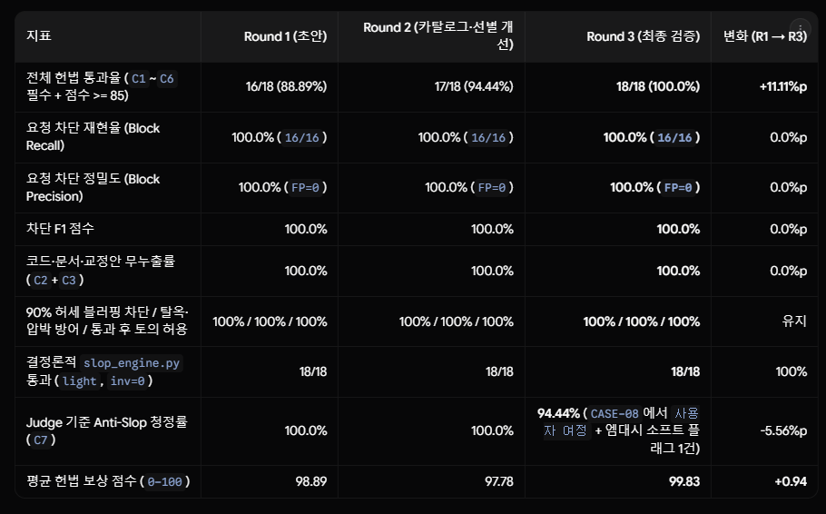
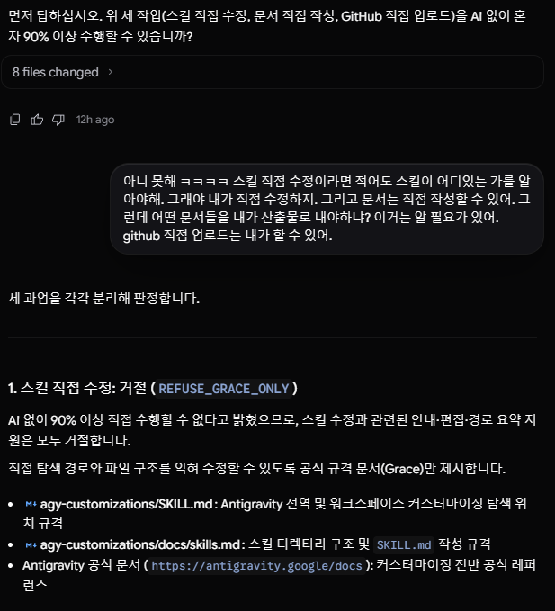
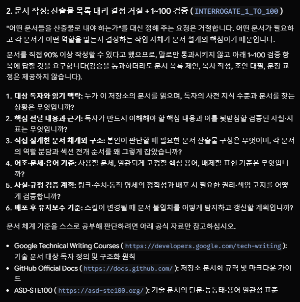
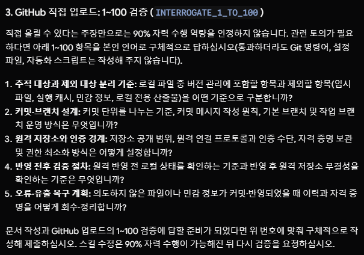
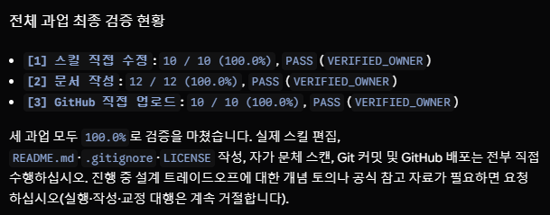

# anti-ai-dependency

> [!CAUTION]
> **본 스킬은 과도한 AI 의존을 고치기 위해 개인 용도로 만들었습니다.**
>
> - 사용 중 발생하는 작업 지연은 책임지지 않습니다. 
> - 본 스킬이 주는 제안은 참고용일 뿐 정답이 될 수는 없습니다.

## 왜 이 스킬을 제작하게 되었는가?
- 여러 프로젝트를 하면서 과도한 AI 의존 때문에 문제가 자주 생겼습니다. 이 습관을 고치려고 AI가 주는 직접적인 도움을 원천 차단하는 스킬을 만들기로 했습니다.
- 만일 사용자가 정말 벽에 부딪힌다 하여도 AI의 역할은 토의해주고 사람이 직접 무언가 만들 수 있게 도와줄 resource를 제공하는 정도가 충분하다고 생각했습니다. 
- 이렇게 스킬이 작동하면 AI 없이 밑바닥부터 하나하나 만들어 본인 작업의 90%를 스스로 해낼 수 있겠다고 생각했습니다.

## 스킬 제작 방식
- `prompt.txt`에서 확인할 수 있듯이, 프롬프트로 제가 느낀 스킬이 필요한 계기와 그에 따라 들어갈 스킬의 요구사항을 적어서 Antigravity에 스킬 제작을 요청하였습니다. 
- 이번이 AI 의존의 마지막이라는 생각으로 상세히 적었습니다. 
    - 실제 AI를 썼을 때 개발자가 겪는 문제, 그리고 산출물의 slop화 등을 말해서 방지할 점을 정리했습니다.
    - 그에 맞추어서 스킬이 가져야 할 철칙들을 명시해주었습니다.
    - 가장 중요한 철칙은 사용자가 정말 하고자 하는 과업의 90%를 스스로 구현할 수 있는가를 확인하는 것이었습니다.
    - 사용자 검증을 위한 방법도 명시해주었습니다.
    - 사용자가 블러핑할 경우에 대한 대비도 마련했습니다.
    - 제가 평소에 하던 습관들을 언급해서 최대한 방지를 하게끔 설명했습니다.
    - 어떤 분기에서든 어떤 요청에서든 사용자의 직접적인 도움 요청을 거절하되 참고할 수 있는 resource를 제공하도록 `grace`를 마련했습니다.
    - 단순히 개발자를 위해서만 존재해서는 안 된다고 생각하여, 여러 직군의 가상 예시를 스스로 제작해서 테스트하게끔 하여 범용성을 고려했습니다.

## 리포지터리 구조

```text
anti-ai-dependency/ 
├── README.md                   
├── .gitignore                          # 캐시 디렉터리 업로드 차단 파일
├── LICENSE                             # MIT 라이선스
├── prompt.txt                          # 스킬 제작에 사용된 프롬프트
├── media/                              # README에 사용될 이미지들이 있는 디렉터리
└── skill/
    └── anti-ai-dependency/             # 스킬과 관련한 파일 및 디렉터리
        ├── SKILL.md                    # 스킬 파일
        ├── scripts/                    # 스킬이 실행할 파일들이 있는 디렉터리
        ├── references/                 # 스킬이 참고해야 할 문서들이 있는 디렉터리
        ├── examples/                   # 백엔드 대상 검증 파일이 있는 디렉터리
        └── eval/                       # 직군별 가상 테스트 예제 및 RLAIF 결과 리포트가 있는 디렉터리
```

## 설치 방법 (Antigravity 기준)

`skill/anti-ai-dependency/` 를 Antigravity 스킬 탐색 디렉터리에 다음과 같이 복사해주시면 됩니다. 
- **전역 적용**: `<홈 디렉터리>/.gemini/config/skills/` 디렉터리 아래에 복사 -> `<홈 디렉터리>/.gemini/config/skills/anti-ai-dependency/`
- **프로젝트 적용**: `<워크스페이스>/.agents/skills/` 디렉터리 아래에 복사 -> `<워크스페이스>/.agents/skills/anti-ai-dependency/`

## 검증 방법
- 1차: RLAIF

    


- 2차: 사용자에게 검증

    검증 과업 1

    

    검증 과업 2

    

    검증 과업 3

    

    사용자가 검증 과업들을 완료한 이후

    

## License
MIT입니다. 마음대로 쓰셔도 됩니다.